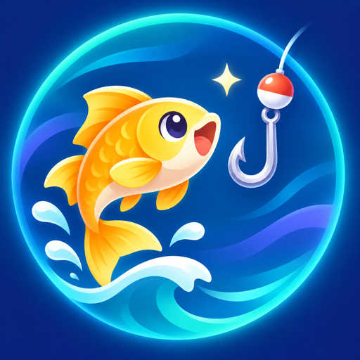

# 全能钓鱼 · AstrBot 插件

AstrBot 钓鱼养成游戏：钓鱼、鱼塘与水族箱、装备精炼、商店、玩家市场、抽卡、偷鱼与电鱼、称号成就。基于 [Akiyo-dayo/astrbot_plugin_fishing](https://github.com/Akiyo-dayo/astrbot_plugin_fishing) v2.6.5 二次开发。

## 安装

在 AstrBot 插件市场安装，或把仓库放到 `data/plugins/astrbot_plugin_fishing` 后安装 `requirements.txt` 并重载插件。数据保存在 `data/plugin_data/astrbot_plugin_fishing/fish.db`，可直接沿用原插件的 `fish.db` 存档；存档里银行活期、定期中的金币，以及交易所持仓和市场上的大宗商品挂单，会在首次加载时折成金币退回玩家钱包。

## 指令

发送 `钓鱼帮助` 查看图片版指令菜单。`[ ]` 为参数，`@用户` 也可以换成用户 ID。

| 分类 | 指令 |
| --- | --- |
| 基础 | `注册` `钓鱼` `签到` `自动钓鱼` `钓鱼区域 [ID]` `钓鱼记录` `状态` `更新昵称 [昵称]` `钓鱼帮助` |
| 背包 | `背包` `鱼塘` `鱼塘容量` `升级鱼塘` `偷看鱼塘 @用户` `鱼竿` `鱼饵` `饰品` `道具` `使用 [ID]` `开启全部钱袋` `精炼 [ID]` `出售 [ID]` `锁定 [ID]` `解锁 [ID]` `金币` `高级货币` |
| 水族箱 | `水族箱` `放入水族箱 [ID] [数量]` `移出水族箱 [ID] [数量]` `升级水族箱` |
| 出售 | `全部卖出` `保留卖出` `出售稀有度 [星级]` `出售所有鱼竿` `出售所有饰品` `砸锅卖铁` |
| 商店与市场 | `商店` `商店购买 [商店ID] [商品ID] [数量]` `市场` `上架 [ID] [价格] [数量] [匿名]` `购买 [ID]` `我的上架` `下架 [ID]` |
| 抽卡 | `抽卡 [卡池ID]` `十连 [卡池ID]` `查看卡池 [ID]` `抽卡记录` |
| 社交 | `排行榜 [类型]` `偷鱼 @用户` `电鱼 @用户` `驱灵 @用户` `转账 @用户 [金额]` `查看称号` `使用称号 [ID]` `查看成就` `鱼类图鉴` |

插件没有管理员指令，所有管理操作都在面板里完成。

## 管理面板

登录 AstrBot 面板，在插件页打开「全能钓鱼」详情，进入「钓鱼管理」视图（也会出现在侧边栏）。页面嵌在 AstrBot 面板中，沿用面板的登录状态和亮暗主题，不另开端口，也没有单独的密码。

| 板块 | 功能 |
| --- | --- |
| 总览 | 玩家数、金币与高级货币总量、市场挂单，常用操作入口 |
| 玩家 | 搜索、新建、编辑、删除玩家；增减或设置金币和高级货币；授予或移除称号；查看并增删库存，修改鱼竿和饰品的精炼等级与耐久 |
| 玩家市场 | 筛选挂单，修改价格，强制下架（物品退回卖家） |
| 商店 | 商店与商品的增删改，商品可设置消耗、奖励、库存、限购和上架时间 |
| 抽卡池 | 卡池增删改与复制，管理卡池物品和权重，显示实际概率 |
| 钓鱼区域 | 区域增删改、稀有度分布、限定鱼类、开放时间、通行证；补充鱼池 |
| 物品模板 | 鱼类、鱼竿、鱼饵、饰品、道具的增删改，CSV 模板下载与批量导入 |
| 称号 | 称号增删改 |
| 全服操作 | 全体发放或扣除货币、全体发放物品、同步初始设定、补充鱼池、代理玩家 |

需要注意的几项：

- **删除物品模板**：仍被玩家库存、钓鱼记录、卡池、商店、市场挂单或区域通行证使用的模板无法删除，页面会提示用在哪里。
- **商店消耗**：标为「必须」的消耗都要支付。标为「可选」且组 ID 相同的几项，玩家只需满足其中一项；组 ID 不同的组之间仍需同时满足。例如「高级货币 ×10 可选 组1」加「创世神鳞 ×1 可选 组1」，表示二选一。不设消耗即为免费。
- **代理玩家**：填写你在聊天平台的账号 ID 和目标玩家 ID 后，你发送的游戏指令会以目标玩家身份执行。重载插件后自动失效。
- **全体操作**：市场托管等系统账号不参与全体发放或扣除。

## 配置

在 AstrBot 的插件配置页修改，保存后重载插件生效。

| 配置 | 默认值 | 说明 |
| --- | --- | --- |
| `fishing.cooldown_seconds` | `180` | 钓鱼冷却（秒） |
| `fishing.quality_bonus_max_chance` | `0.35` | 装备品质加成触发高品质鱼的概率上限 |
| `steal.cooldown_seconds` | `14400` | 偷鱼冷却（秒） |
| `electric_fish.enabled` | `true` | 是否开放电鱼 |
| `electric_fish.cooldown_seconds` / `electric_fish.base_success_rate` | `7200` / `0.6` | 电鱼冷却（秒）与基础成功率 |
| `electric_fish.failure_penalty_max_rate` | `0.5` | 电鱼失败时最多扣除的金币比例 |
| `game.daily_reset_hour` | `0` | 每日刷新时间（0-23 点），用于重置稀有鱼配额和检查区域通行证 |
| `user.initial_coins` | `200` | 新玩家初始金币 |
| `user.transfer_fee_rate` | `0.05` | 转账手续费率，由转出方额外支付，0 表示不收费 |
| `market.listing_tax_rate` | `0.05` | 玩家市场上架手续费率 |
| `sell_prices.by_rarity_1` ~ `by_rarity_5` | `100` ~ `10000` | 鱼竿、饰品按稀有度的回收价（精炼等级越高倍率越高） |

## 交流与反馈

使用问题、Bug 反馈和功能建议欢迎加群交流：

<table>
  <thead>
    <tr><th>吟枢苑✨吟窝（插件反馈群）</th></tr>
  </thead>
  <tbody>
    <tr><td align="center">群号：1059351824</td></tr>
    <tr><td align="center"></td></tr>
  </tbody>
</table>

## 参考与许可

基于 [AstrBot](https://github.com/AstrBotDevs/AstrBot) 插件接口开发，原作 [0xNMLSS](https://github.com/0xNMLSS/astrbot_plugin_fishing)、[xxlemon-io](https://github.com/xxlemon-io/astrbot_plugin_fishing)、[Akiyo-dayo](https://github.com/Akiyo-dayo/astrbot_plugin_fishing)。以 [AGPL-3.0](LICENSE) 许可发布。
